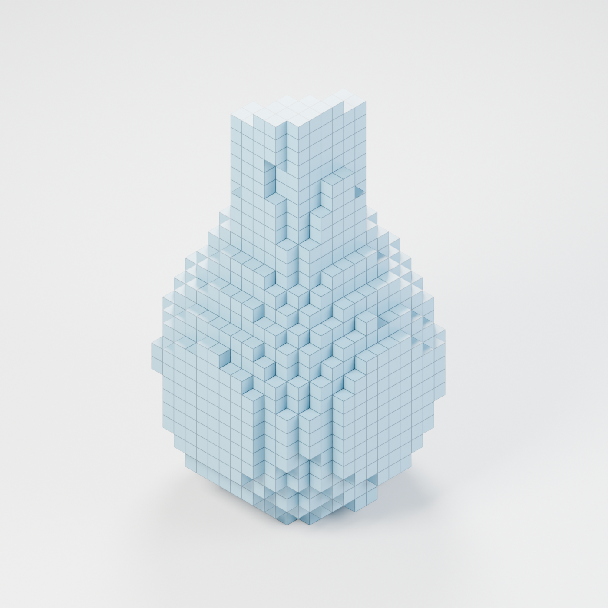
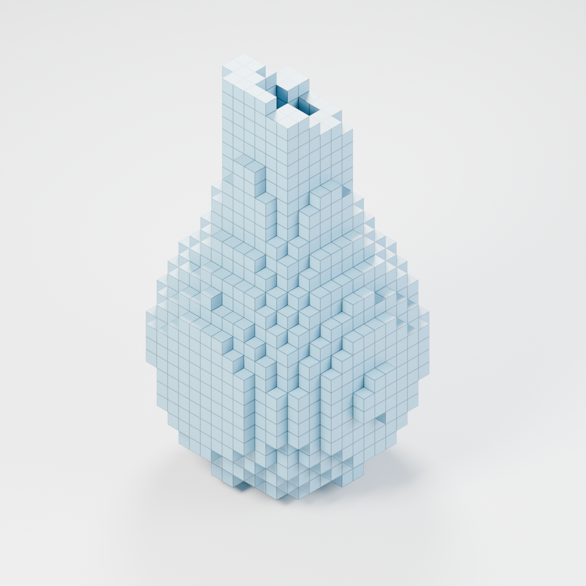
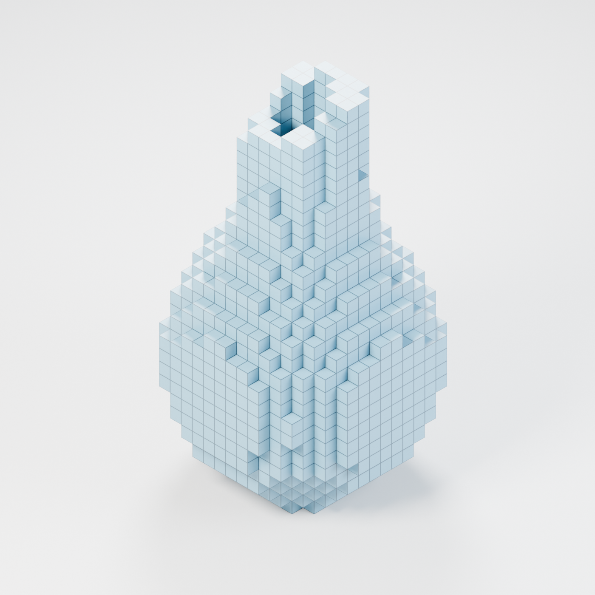
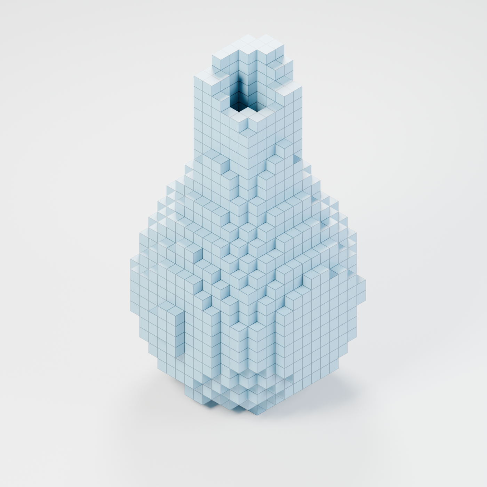

# Voxel Vase

**Design ID:** VXL-VASE-001 · **Version:** v01

**Designer:** Maxim Bezverhnii · [Email](mailto:offmonreall@gmail.com) · [@offmonreal](https://github.com/offmonreal)

A decorative vase with an asymmetrical, stepped silhouette and an off-center opening. The model shown measures **85 × 80 × 150 mm**.

These four isometric renders show the same build123d model from different angles. The fine lines mark the **5 mm voxel grid**.

| Front left | Front right |
| --- | --- |
|  |  |

| Rear left | Rear right |
| --- | --- |
|  |  |

## License

© 2026 Maxim Bezverhnii. Individuals may keep the renders and make the vase for their own private, noncommercial use. Commercial use, paid printing, sale, and redistribution require separate written permission. See the [Voxel Vase Personal Use License](LICENSE.md).
